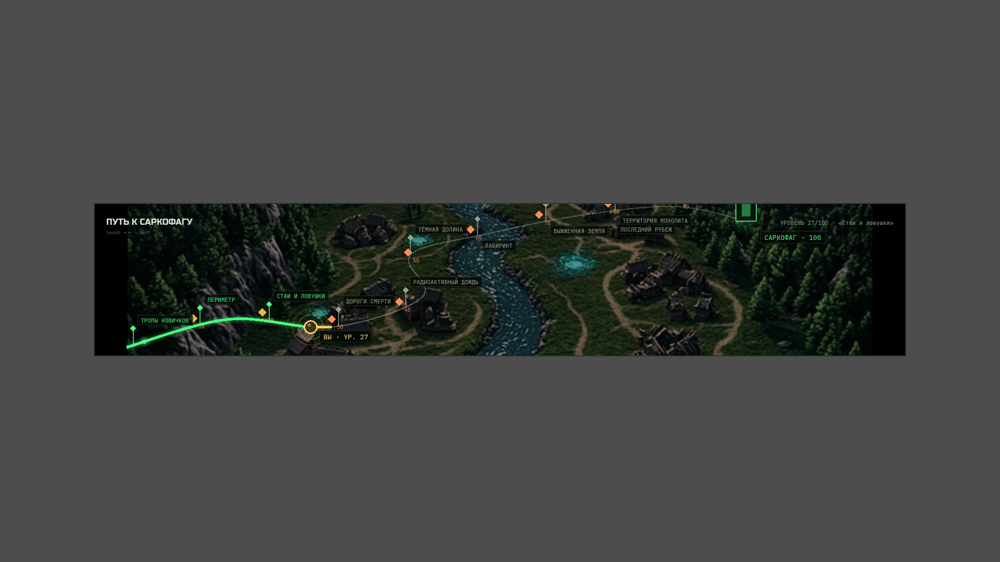
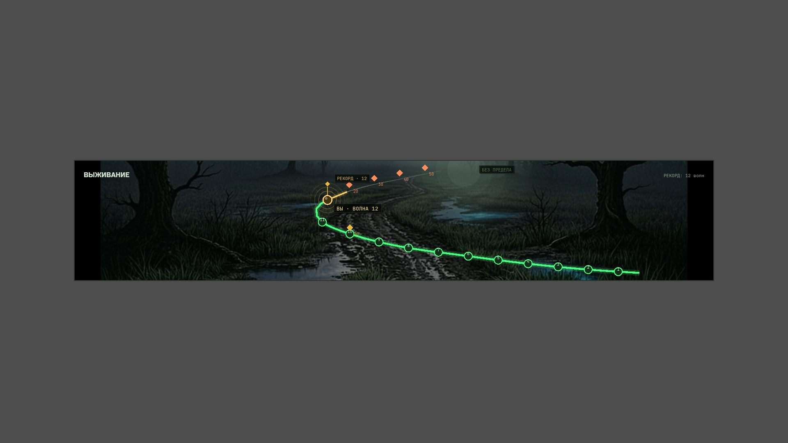
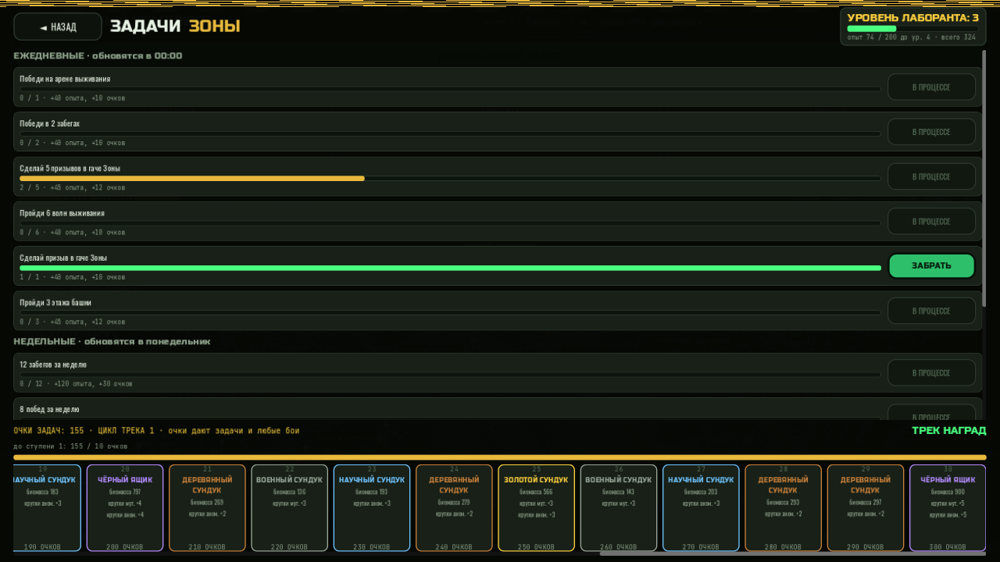

# STALKER REVERT · «Сталкер наоборот»

  

Стратегия в реальном времени, где игрок управляет **самой Зоной**. Сталкеры приходят на территорию, чтобы украсть артефакты, а Зона защищается: создаёт аномалии, призывает мутантов, управляет ресурсами и устраивает выбросы.

| Кампания «Карта Зоны» | Выживание «Тропа в туман» | Трек наград |
|---|---|---|
|  |  |  |

## Скачать

Готовые сборки (ПК + Android) — в разделе [**Releases**](https://github.com/hakkiller/StalkerReverT/releases):

| Версия | Имя | Бины |
|---|---|---|
| [v0.20.0](https://github.com/hakkiller/StalkerReverT/releases/tag/v0.20.0) | «ПРАВО ВЫБОРА» — приз на выбор за 20 супер-круток; топ арены по волнам | ПК · APK |
| [v0.16.0](https://github.com/hakkiller/StalkerReverT/releases/tag/v0.16.0) | «Геофизик» | ПК · APK |
| [v0.18.0](https://github.com/hakkiller/StalkerReverT/releases/tag/v0.18.0) | «СУПЕР-ПРИЗЫВ» — супер-гача: 6 эксклюзивов Чёрных ящиков + бонус 60 круток | ПК · APK |
| [v0.19.0](https://github.com/hakkiller/StalkerReverT/releases/tag/v0.19.0) | «БАЗАР» — очки сезона: магазин СЕЗОН (эксклюзивы ЧЯ за СП, крутки, био, копии) + ОБМЕННИК (артефакты выбросов и био → СП); фикс счётчиков арен-побед | ПК · APK |
| [v0.17.1](https://github.com/hakkiller/StalkerReverT/releases/tag/v0.17.1) | «Утилизатор» (хотфикс) — награды арены, фикс трупов | ПК · APK |
| [v0.17.0](https://github.com/hakkiller/StalkerReverT/releases/tag/v0.17.0) | «Утилизатор» — фильтр редкости + «Утилизировать всё» | ПК · APK |
| [v0.16.1](https://github.com/hakkiller/StalkerReverT/releases/tag/v0.16.1) | «Геофизик» (хотфикс набора) | ПК · APK |
| [v0.15.0](https://github.com/hakkiller/StalkerReverT/releases/tag/v0.15.0) | «Зоолог» | ПК · APK |
| [v0.14.0](https://github.com/hakkiller/StalkerReverT/releases/tag/v0.14.0) | «Интендант» | ПК · APK |
| [v0.13.0](https://github.com/hakkiller/StalkerReverT/releases/tag/v0.13.0) | «Лаборант» | ПК · APK |
| [v0.12.0](https://github.com/hakkiller/StalkerReverT/releases/tag/v0.12.0) | «Проводник» | ПК · APK |
| [v0.11.0](https://github.com/hakkiller/StalkerReverT/releases/tag/v0.11.0) | «Тропа в туман» | ПК · APK |

### Установка ПК

1. Скачай `stalker-revert-pc-vX.Y.Z.zip` из релиза и **распакуй** (не запускай изнутри архива).
2. Windows SmartScreen: «Подробнее» → «Выполнить в любом случае».
3. Если чёрный экран (нет Vulkan) — запусти `START_COMPAT.bat`.

### Установка Android

1. Скачай `stalker-revert-android-vX.Y.Z.zip` и распакуй.
2. Установи `stalkerrevert_vX.Y.Z.apk` (разреши установку из неизвестных источников).
3. Обновление ставится поверх старой версии, сейвы совместимы.

## Режимы

### Кампания «100 колец Зоны»

Кампания на 100 уровней: уровень = один забег, победа открывает следующее кольцо.
10 глав, именные караваны-боссы каждые 10 уровней, три режима сложности.
Прокачка лаборатории растянута на всю кампанию: расширенные тиры улучшений
открываются прогрессом (кольца 40/45/65/70/85). Весь баланс кампании — в
`data/campaign_data.gd`, дизайн и математика — в `docs/campaign_design.md`.

### Башня Монолита

100 этажей с растущей сложностью: звёзды (1-3) за условия этажа, биомасса
и крутки гачи в награду. Каждый 5-й этаж — «Прорыв» (×1.5 награды),
каждый 10-й — именной «Хранитель» (×3). Панель — кнопка «Башня»
в лаборатории. Дизайн — `docs/tower_design.md`, баланс — `data/tower_data.gd`.

### Режим выживания

Волны бесконечны и становятся сильнее с каждой, награда растёт с числом
пройденных волн (платится даже за поражение). Забег заканчивается гибелью Зоны,
рекорд волн хранится в статистике. Баланс — в `data/survival_data.gd`.

## Прогресс лаборанта

- **Уровень лаборанта** — опыт идёт со всех боёв, задач и гачи; за уровень +1 крутка.
- **Задачи Зоны** — 16 дневных и 14 недельных в пулах (активны 6+5), ротация по дате и неделе.
- **Сезонный трек наград** — 30 ступеней сундуков: деревянные/военные/научные/золотые,
  на 10/20/30 — «Чёрный ящик». Награды растут к концу трека до +50%; закрыл сезон —
  цикл заново, сундуки жирнее на 25%.
- **Эксклюзивные мутанты** — Чёрный ящик несёт питомца коллекции: Альфа-псевдопёс,
  Пепельный снорк или Чёрный контролёр (ротация по циклам). Свой окрас, статы и подпись;
  каждый забег начинается с ними у монолита, дубликат — звёздный корм.
- **Онбординг с сюжетом** — Проводник ведёт кампанию (диалоги между главами),
  Диспетчер встречает на арене выживания, Старожил — у врат башни.

## Версионирование

Формат: **v0.X.Y «Кодовое имя»** — X контентный этап, Y хотфикс. Полная история — [VERSIONING.md](VERSIONING.md). Каждый релиз тегируется: `v0.11.0` … `v0.14.0`.

## Сборка из исходников

1. Склонируй репозиторий и открой папку в **Godot 4.6.1+** — проект импортируется сам.
2. Для экспорта нужны пресеты из `export_presets.cfg` (Windows Desktop, Android).
3. Headless-импорт: `godot --headless --path . --import`.

### Структура проекта

- `core/` — гейм-менеджер, прогресс (задачи, трек, XP), гача, сюжет
- `managers/` — аномалии, туман, события, спавн, ресурсы, звук
- `data/` — балансовые данные (кампания, башня, выживание, гача)
- `scenes/`, `entities/`, `anomalies/` — сцены и игровые объекты
- `ui/` — интерфейс (лаборатория, профиль, панели режимов)
- `zones/` — контексты Зоны, `docs/` — дизайн-документы
- `android/` — сборка APK, `models/` — пропсы сцены

### Технологии

- Godot 4.6.1, GDScript
- GLM и Qwen для архитектурного проектирования и кодогенерации

## Атрибуция

- Картовые данные Припяти: © участники [OpenStreetMap](https://www.openstreetmap.org/copyright), ODbL 1.0. Высоты: AWS Terrain Tiles / SRTM (NASA/USGS).
- Модели пропсов: Kenney (CC0), Quaternius (CC0), а также **Bus, Swing set, Tumbleweed, Dead Tree by Poly by Google, CC-BY 4.0** и **Dead Tree Trunk, Bus Stop by Zsky, CC-BY 4.0** (poly.pizza). Полные списки: `models/props/CREDITS.md`, `models/animals/CREDITS.md`, `assets/textures/CREDITS.md`, `assets/audio/CREDITS.md`.
